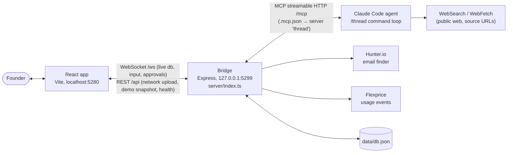

# The Thread: architecture

## Overview

The Thread is a local web app plus a small bridge server. The founder works in the React app; the actual GTM work (ICP, research, scoring inputs, drafting, reviewing) is done by a Claude Code session that connects to the bridge as an MCP client and calls its tools. The bridge owns all state (one JSON file), computes warm paths and scores deterministically in `shared/logic.ts`, calls Hunter.io for emails and Flexprice for usage, and pushes every change to the app over a WebSocket. The founder approves, edits or rejects every draft; nothing is sent.

## Diagram



ASCII version:

```
Founder
  |
React app :5280  --(Vite proxy)-->  /ws  WebSocket  (db push, tasks, approvals)
                                    /api REST       (Connections.csv, demo snapshot, health)
                                         |
                              Bridge :5299 (server/index.ts) ---- data/db.json
                               |        |            |
                    /mcp (streamable HTTP)   Hunter.io      Flexprice
                               |
                     Claude Code  (/thread loop)
                               |
                     WebSearch / WebFetch
```

Request flow: the founder types in the app → the bridge queues a task → the agent's long-poll `wait_for_task` returns it with a state summary → the agent researches and calls tools → each tool call mutates `db`, writes to disk (debounced 300 ms) and broadcasts the new `db` to every open tab.

## Why Claude Code is the engine (via MCP)

- No Anthropic API key in the app. The founder runs `claude "/thread"` in the project folder; `.mcp.json` points it at `http://127.0.0.1:5299/mcp`.
- Claude Code already has WebSearch and WebFetch. Every company, person, signal and competitor the agent saves must carry a source URL it read (`sources` is a required, non-empty array in the tool schemas), so citations are a byproduct of how it researches.
- The bridge stays small and deterministic: it validates input with zod, stores, scores and meters. Judgement lives in the agent; arithmetic lives in code.
- The agent loop is defined in `.claude/commands/thread.md`, with the same rules repeated in the MCP server `instructions`.

## The knowledge graph

The data model in `shared/types.ts` is a graph stored as JSON. Nodes are records; edges are fields that reference other records or match by organisation name (`sameOrg` in `shared/logic.ts`).

| Node | Stored as |
|---|---|
| Company | `db.companies` (industry, NAICS, employees, sources, optional negative signal) |
| Person (buyer) | `db.people` (title, seniority, past companies, schools, communities, stage) |
| Contact | `db.founder.network` (LinkedIn export rows, plus customers/people met, plus typed) |
| Founder | `db.founder` (schools, past companies, communities) |
| Competitor | `db.competitors` (positioning, pricing, differentiators) |
| Signal | `db.signals` (hiring, funding, launch, leadership, tech, news, job_change) |
| Draft | `db.drafts` (touches, claims, review, status) |

| Edge | Comes from |
|---|---|
| works_at | `Person.companyId`; `Contact.company` |
| previously_employed_at | `Person.pastCompanies`; `Founder.pastCompanies` |
| knows | Founder → Contact (every network row) |
| studied_at | `Person.schools`; `Founder.schools` |
| part_of (community) | `Person.communities`; `Founder.communities` |
| competes_with | Competitor ↔ founder's product; Company uses Competitor via tech signals |
| matched_to | Person → ICP (scored lead) |
| contacted_via | Draft → Contact (`viaContactId` on intro requests) |
| replied_to | Person stage `replied` / `meeting` / `closed` |

Named multi-hop queries (`graph_query` tool):

- `warm_paths`: Founder → knows → Contact → works_at → Company ← works_at ← Person.
- `hiring_signals`: Signal[hiring] → Company → Person matching a persona.
- `competitor_displacement`: Company with a signal naming a Competitor → its buyers.
- `super_connectors`: Contacts ranked by how many non-excluded leads their path opens.
- `job_changes`: Contacts whose company changed, flagged when the new one is a target company.

The graph runs in memory over `db` today. The production path is to mirror it into Neo4j (the `.env.example` has `NEO4J_*` placeholders) and run the same five queries as Cypher; that mirror is not built yet.

## Scoring (`scoreLead` in `shared/logic.ts`)

Score 0–100 = fit + intent + warm. Every point added also adds a human-readable reason shown in the Leads row.

- **Fit, up to 60**
  - Industry matches an ICP industry: +20
  - Employees inside the ICP range: +15; within half the min to twice the max: +6
  - Title matches a persona (2+ shared words, or all words for short titles): +15; partial match: +7
  - Decision-maker seniority (head, director, vp, chief, founder, lead, manager): +10
  - Unknown headcount: fit is rescaled from the 45 points that could be judged to 60 (`fit * 60 / 45`), so a missing size does not sink a lead.
- **Intent, up to 25**: first 3 signals; hiring or funding +10 each, other kinds +6 each; capped at 25.
- **Warm, up to 15**: strength of the best warm path × 15.
- **Negative signal** on the company (layoffs, competitor customer, wrong segment, with a source): score capped at 20 and the lead is marked excluded.
- **Tiers**: A ≥ 75, B ≥ 50, else C.

## Warm paths (`warmPaths` in `shared/logic.ts`)

| Kind | Rule | Strength |
|---|---|---|
| colleague | a Contact works at the lead's current company | 1.0 |
| former_colleague | a Contact works at one of the lead's past companies | 0.6 |
| shared_employer | the founder and the lead share a past employer | 0.4 |
| shared_school | the founder and the lead share a school | 0.35 |
| shared_community | the founder and the lead share a community, accelerator, event or podcast | 0.3 |

Paths are sorted by strength and de-duplicated per kind and hop. The first two kinds carry a `viaContactId`, which is what an intro request is addressed to.

## Proof-first outreach

1. `draft_outreach` takes 1–4 touches (email or LinkedIn, with day offsets), variant A or B, an angle, and `claims[]`: each factual sentence with the URL that supports it. Kinds: `intro_request` (to the mutual contact; requires `via_contact_id`), `cold` (to the lead), `referral_ask` (to a closed customer).
2. The agent, acting as Reviewer, calls `review_draft` with `pass` or `fix` and the list of unsupported sentences. Proof score = sourced claims / (claims + unsupported) × 100. A `fix` verdict means redraft.
3. The founder sees the draft as an email with footnoted sources and chooses Approve, Edit or Reject (with a reason). Approve sets status to approved ("queued"), moves the lead to Contacted and meters `outreach_sent`. No email or LinkedIn message is actually sent.

## Learning loop: every deal grows your network

- **Rejection patterns**: when 2+ rejected drafts share an industry, the bridge queues a task asking the agent to call `suggest_icp_change`. The founder accepts or dismisses the card; the agent never changes the ICP on its own.
- **ICP expansions**: `save_icp` includes 2–4 expansion suggestions the founder can accept, adjust or dismiss; accepting queues a re-save and more discovery.
- **Deals**: moving a lead to Meeting or Closed adds them to the founder's network as a Contact (origin `met` or `customer`), so they open paths to their colleagues and ex-colleagues. Closed also queues a `referral_ask` draft naming 1–2 specific people.
- **Job changes**: `update_contacts` records moves; a move into a target company becomes a `job_change` signal on that company.
- **Communities**: sourced off-LinkedIn contexts on people and the founder produce `shared_community` paths.
- **People to meet**: `suggest_connectors` saves 3–5 non-buyers who sit next to several buyers; marking one as met adds them to the network.

## Metering and credits (`server/meter.ts`)

Three meters, counted locally in `db.usage` and shown in the app: `leads_enriched`, `outreach_sent`, `graph_queries`. When `FLEXPRICE_API_KEY` is set, each increment is also sent as a Flexprice usage event (`POST {FLEXPRICE_API_URL}/events` with `event_name`, `external_customer_id`, `properties.count`). Credits start at `CREDITS` (default 50). Each new Hunter lookup costs 1 credit; cached results are free; enrichment is refused at 0 credits. Outreach and graph queries are metered but free.

## Privacy

- No passwords, no logins on the founder's behalf, no scraping of logged-in sites.
- The founder's network comes only from their own LinkedIn `Connections.csv` export, plus schools, past companies and communities they type in.
- LinkedIn exports from Dec 2026 contain names and profile URLs but no company or title. The agent fills companies in from public pages (`list_contacts missing_company=true` → `update_contacts`, `source_url` required) and skips anyone it cannot source. The founder can also fill them in by hand.
- Everything stays local: `data/db.json` on the founder's machine; the bridge listens on 127.0.0.1 only and checks the Host header. External calls are Hunter (name + company domain) and Flexprice (counts only).
- Every action by the agent or the founder is written to the audit log (Insights page).

## Hackathon brief → files

| Brief item | What it is | Files |
|---|---|---|
| 1 Intake & ICP | Brief chat → ICP with confidence per field, expansion cards | `src/ui/Brief.tsx`, `src/ui/Start.tsx`, `src/ui/Icp.tsx`, `save_icp` in `server/index.ts` |
| 2 Discovery | Sourced companies, buyers, signals, competitors; negative-signal exclusion | `add_companies` / `add_people` / `add_signals` / `add_competitors` in `server/index.ts`, `src/ui/Leads.tsx`, `.claude/commands/thread.md` |
| 3 Knowledge graph | Nodes/edges, warm paths, named multi-hop queries, super-connectors | `shared/types.ts`, `shared/logic.ts`, `graph_query` / `find_warm_paths`, `src/ui/Network.tsx` |
| 4 Enrichment & outreach | Hunter emails (cached, credit-gated), multi-touch A/B sequences, intro vs cold, Reviewer, approval gate | `server/hunter.ts`, `draft_outreach` / `review_draft`, `src/ui/Outreach.tsx` |
| 5 Dashboard | Kanban stages, fit & intent tiers, AI-vs-founder attribution, conversion, A/B, warm vs cold, audit log, agent feed | `src/ui/Pipeline.tsx`, `src/ui/Insights.tsx`, `src/ui/Chrome.tsx` (feed) |
| Bonus: Flexprice | Three meters, credits in the top bar, enrichment blocked at 0 | `server/meter.ts`, `server/hunter.ts` |
| Bonus: multi-agent roles | One Claude Code session plays planner, scout, writer, reviewer (each tool call tagged with `agent`) | `server/index.ts`, `.claude/commands/thread.md` |

## MCP tools (`server/index.ts`)

| Tool | What it does |
|---|---|
| `wait_for_task` | Long-polls (up to 90 s) for the founder's next input; returns it with a state summary. |
| `get_state` | Full state as JSON: ICP, companies, competitors, scored leads with paths, drafts, network size. |
| `think` | Adds a line to the live agent feed, tagged with the agent role. |
| `say` | Chat message to the founder, with up to 3 buttons that open a workspace page. |
| `ask_founder` | Question with 2–4 options; the answer arrives through `wait_for_task`. |
| `save_icp` | Saves the ICP (industries, size, personas, triggers, geos, negatives, each with confidence) and expansion suggestions. |
| `add_competitors` | Saves competitors with positioning, pricing, differentiators and sources. |
| `add_companies` | Saves target companies with sources; optional sourced negative signal excludes a bad fit. |
| `add_people` | Saves role-matched buyers at saved companies, with past companies, schools, communities and sources. |
| `add_signals` | Saves hiring, funding, launch, leadership, tech or news signals with their URL. |
| `enrich` | Finds work emails through Hunter.io; 1 credit per uncached person. |
| `find_warm_paths` | Runs the warm-path check against the founder's network; returns scored leads with paths. |
| `list_contacts` | Lists the founder's connections, optionally only those missing a company. |
| `update_contacts` | Fills in a connection's current company from a public source; records job changes. |
| `suggest_connectors` | Saves 3–5 people to meet who sit next to several buyers, with sources. |
| `graph_query` | Runs a named query: `warm_paths`, `hiring_signals`, `competitor_displacement`, `super_connectors`, `job_changes`. |
| `draft_outreach` | Saves a sequence (intro_request, cold or referral_ask) with touches and sourced claims, pending approval. |
| `review_draft` | Reviewer verdict (pass/fix), unsupported sentences, proof score. |
| `suggest_icp_change` | Proposes an ICP change with evidence; the founder accepts or dismisses. |

REST on the bridge: `POST /api/network` (CSV + background), `POST /api/demo/save`, `POST /api/demo/load`, `POST /api/reset`, `GET /api/health`.
