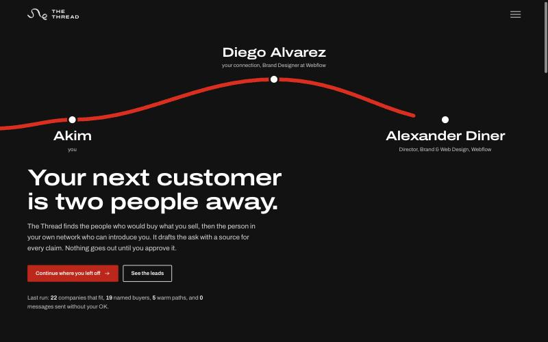

# The Thread

The Thread is a go-to-market agent for founders: it turns a product description into a customer profile, finds real companies and buyers on the public web, and checks the founder's own network for someone who can introduce them. Every claim in every draft links to its source, and nothing is sent: the founder approves, edits or rejects each message.

Built for HackwithBay 4.0 (theme: Thoughtful Agents for Productivity).



## Quick start

Requirements: Node 20+ and [Claude Code](https://claude.com/claude-code).

```bash
npm install
cp .env.example .env   # optional: HUNTER_API_KEY (emails), FLEXPRICE_API_KEY (usage billing)
npm run dev            # bridge on 127.0.0.1:5299, app on http://localhost:5280
```

Open http://localhost:5280. Then, in another terminal in this folder:

```bash
claude "/thread"
```

Approve the `thread` MCP server when Claude Code asks (it is defined in `.mcp.json`). The agent now waits for you in the app. The "Get started" guide in the app walks through the same steps: about you, your network, connecting the agent, what you sell.

Without keys the app still works: emails are skipped without a Hunter key, and usage is counted locally without a Flexprice key.

## How a run works

1. You describe what you sell on the Brief page. The agent saves a customer profile with a confidence for each field and a few expansion ideas you can accept or dismiss.
2. It searches the public web for competitors, 8–12 fitting companies and 1–2 buyers at each, plus hiring, funding and launch signals. Every record has source links; bad fits are excluded with a sourced reason.
3. You upload your LinkedIn `Connections.csv` and add your schools, past companies and communities on the Network page. If the export has no companies, the agent looks them up on public pages.
4. Each lead gets a 0–100 fit and intent score (Tier A/B/C) and its best warm path, for example You → your connection → the buyer.
5. For Tier A/B leads the agent drafts a sequence: an intro request to the mutual connection when a path exists, otherwise a cold email. A reviewer pass flags any sentence without a source.
6. You approve, edit or reject each draft on the Outreach page. Rejections with a pattern lead to a suggested profile change.
7. You move leads across the Pipeline board. Meetings and closed deals join your network, and a closed deal triggers a referral ask.

## Demo snapshot

To see a finished run without waiting for the agent: open the menu → **Load demo snapshot**. **Save demo snapshot** in the same menu stores the current state to `data/demo-snapshot.json`.

## Tech stack

- React 19, Vite, TypeScript, Zustand (`src/`)
- Express 5 bridge with the MCP TypeScript SDK (streamable HTTP), `ws` WebSocket, zod (`server/`)
- Shared, pure scoring and warm-path logic (`shared/`)
- Claude Code as the agent, with its built-in WebSearch and WebFetch
- Hunter.io for email finding, Flexprice for usage metering
- Storage: one JSON file, `data/db.json`

See [ARCHITECTURE.md](ARCHITECTURE.md) for the diagram, data model, scoring rules, MCP tools and how the hackathon brief maps to files.

## Privacy

No passwords and no scraping of logged-in sites. Your network comes only from your own LinkedIn export and what you type. Everything is stored locally; the bridge listens on 127.0.0.1 only.

## Security

Snyk scan: see below.

- `snyk test`: TODO
- `snyk code test`: TODO
